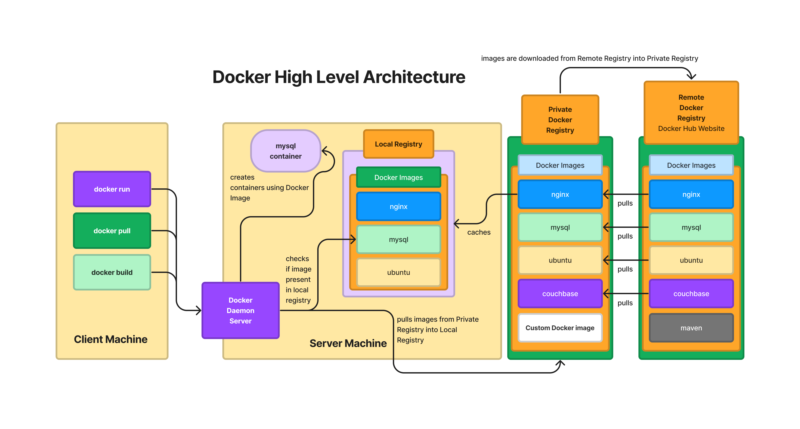
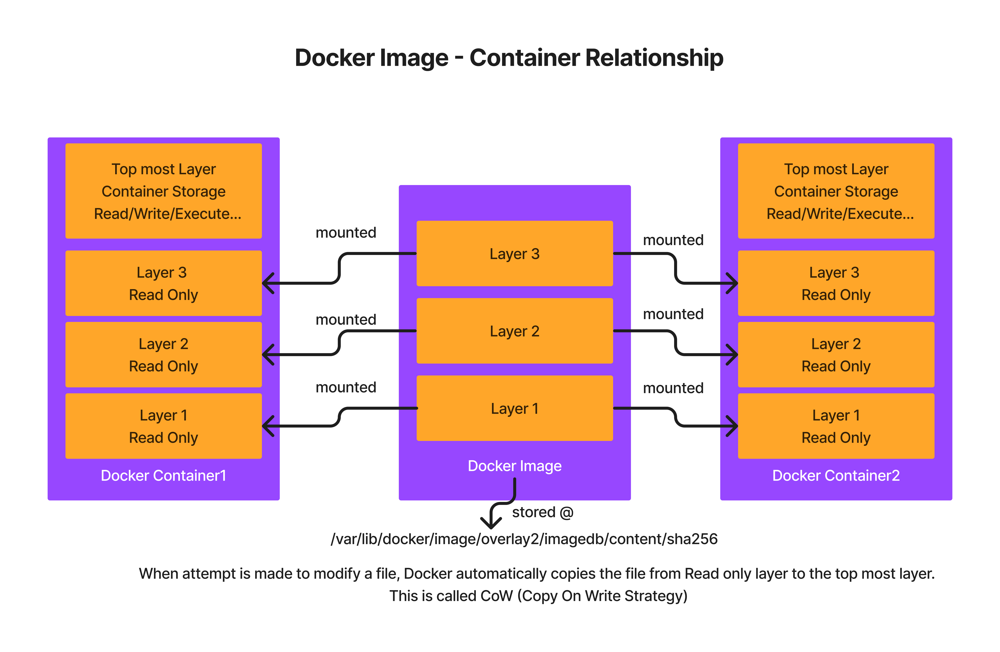

## Info - Hypervisor Overview
<pre>
- Hypervisor is nothing but Virtualization
- Virtualization helps us run multiple OS on your laptop/desktop/workstation/server
- i.e more than 1 OS can run side-by-side on your machine
- there are 2 types of Hypervisors
  1. Type 1 - a.k.a Bare Metal Hypervisors
     - is used in Servers & Workstations
     - near native-hardware performance
     - examples
       - KVM ( supported in all Linux distributions, free & opensource )
       - VMWare vSphere(vCenter)
       - Microsoft Hyper-V
       
  2. Type 2 - a.k.a Hosted Hypervisors
     - is used in Laptops/Desktops & Workstations
     - slightly slower
     - examples
       - Oracle VirtualBox ( Free - Supports Windows, Linux & Mac )
       - VMWare Workstation ( Free - Supports Windows & Linux )
       - VMWare Fusion ( Supports only Mac and requires a commercial license )
       - Parallels ( Supports only Mac and requires a commercial license )
- each OS that runs on top Hypervisor is called a Guest OS
- Guest OS requires it own Virtual Machine (VM)
- each Virtual Machine must be allocated with dedicated Hardware resources
  - CPU Cores ( Actual )
  - RAM ( Actual )
  - Storage ( Actual )
  - Network Card ( Virtual )
  - Graphics Card ( Virtual )
- Because every VM requires dedicated H/w resources, this type of Virtualization is called heavy-weight
</pre>

## Info - Processors
<pre>
- Modern Processors generally supports multiple CPU Cores
- each Processor may host 2/4/8/16/32/64/128/256 Cores
- In motherboard, the Processors sockets supports two type of packaging
  1. SCM ( Single Chip Module )
     - the Integrated Circuit has 1 Processor in it
  2. MCM ( Multi Chip Module )
     - the Integrated Circuit has more than 1 Processor in it
- Generally Server Motherboards supports multiple Processor Sockets
  - In 2012, I have Server motherboard with 8 Processor Sockets
  - Assume if we install a MCM IC with 2 Processors ( each Processor having 128 CPU Cores )
  - Total Physical CPU Cores = 8 x 2 x 128 = 2048 CPU Cores
  - AMD supports 2 logical core per Physical CPU - it is called SMT
  - Intel also supports 2 logical core per Physical CPU - it is called Hyperthreading
  - Logical/Virtual CPU Core in total = 2 x 2048 = 4096 Cores
  - easily the server can host 1024 Virtual Machine - each VM allocated with 4 CPU Cores 
- each VM, represents one fully function Operating System with its own OS Kernel, hardware resources, etc.,
</pre>

# Info - Hypervisor High-Level Architecture


## Info - Containerization
<pre>
- Containerization is a light-weight application virtualization technology
- each Container represents one application process in the Operating System
- in some cases, more than container put together represents a single application
- even in a laptop/desktop with regular/decent hardware configuration, we can easily run 10~20 containers
- firewall/proxy, creating different networks can all be done with software, hence with containers
  we could simulate many complex scenarios just like how they would run in production, hence many issues
  could be caught during dev/qa cycle itself
- this is a linux technology
  - Linux kernel has 2 features
    1. Namespace and
       - helps in isolating one container from the other container
    2. Control Group
      - helps in applying container level resource quota restrictions
        - For instance, we can control, 
          - how much/many CPU Core one container can access at the max
          - how much store one container can access at the max
- Container Runtime
  - examples
    - cRun
    - runC
    - CRI-O
- Container Engine
  - examples
    - Docker
    - Podman
</pre>

## Info - Container Runtime
<pre>
- is a low-level software that helps us manage Container images and Containers
- it is not so user-friendly, hence the end-user don't use this directly
</pre>

## Info - Container Engine
<pre>
- Container Engines are high-level software that helps us manage Container images and Containers
  without knowing low-level Linux Kernel Container features
- it provides user-friendly commands to manage images and containers
- it depends on Container Runtimes to manage Images and Containers
- examples
  - Docker Container Engine depends on containerd interface which in-turn depends on runC Container Runtime
  - Podman Container Engine depends on CRI-O Container Runtime
</pre>

## Info - Docker High-Level Architecture



## Info - Docker Image
<pre>
- is a blueprint/template of a Container
- usually Container Image has a single application + all its dependencies
</pre>

## Info - Docker container
<pre>
- is an instance of a Docker Image
- application process that runs in a separate namespace
</pre>

## Info - Container vs Virtual Machine
<pre>
- Containers has its own Network namespace just like Virtual machines
- Containers has its own file system just like Virtual machine
- Containers gets one or more IP addresses just like Virtual machines
- Containers get its own Port range 0-65535 just like Virtual machines
- Containers has one or more software defined(virtual) network card(s) just like Virtual machines
- Container has its is PID (Process ID namespaces )
- every container uses about 5~6 namespaces
- it is for these reasons, people tend to compare a Virtual machine with a container
- containers has its own network stack ( 7 OSI layers ) just like OS/VMs
- otherwise, in general comparing a container with a virtual machine is technically wrong
  - Virtual machine represents a fully functional Operating System
  - Container represents one single application
  - hence, comparing MS Word with Ubuntu is technically wrong
</pre>

## Lab - Finding docker version details
```
docker --version
docker info
```


## Lab - Listing all docker images in your Docker Local Registry
```
docker images
```


## Lab - Downloading docker image from Remote Registry to Local Registry
```
docker pull mysql:9.7.4
docker images
```

## Lab - Finding the image layers ( or more detailed info about a docker image )
```
docker image inspect mysql:latest
docker image inspect mysql:9.7.4 
```

## Lab - Creating an ubuntu container in background(daemon mode)
```
docker run -dit --name ubuntu1-jegan --hostname ubuntu1-jegan ubuntu:latest /bin/bash
docker run -dit --name ubuntu2-jegan --hostname ubuntu2-jegan ubuntu:latest /bin/bash

```

Note
<pre>
dit - runs the container in background, it stands for interactive terminal
name - name of the container as referred by docker server
hostname - used by OS as an alternate to IP address
ubuntu:latest - name of the docker image and tag/version is latest
/bin/bash - after creating the container, you wish to launch the bash terminal
</pre>

## Lab - Listing all running containers
```
docker ps
```


## Lab - Listing all containers even the ones that are not running
```
docker ps -a
```

## Lab - Getting inside a running container shell
```
docker ps
docker exec -it ubuntu1-jegan /bin/bash
hostname
hostname -i
ls
exit
```

## Lab - Deleting a customer image from Local registry
```
docker images
docker rmi hello-world:latest
docker images
```

## Lab - Stopping a running container
```
docker ps
docker stop ubuntu1-jegan
docker ps
```

## Lab - Listing a non-running container
```
docker ps -a
```

## Lab - Starting an exited container
```
docker ps -a
docker start ubuntu1-jegan
docker ps
```

## Lab - Restarting a container
```
docker restart ubuntu1-jegan
docker ps | grep ubuntu1-jegan
```

## Lab - Deleting a running container gracefully
```
docker stop ubuntu1-jegan
docker rm ubuntu1-jegan
docker ps -a | grep ubuntu1-jegan
```

## Lab - Deleting a running container forcibly
```
docker rm -f ubuntu2-jegan
docker ps -a | grep ubuntu2-jegan
```


## Lab - Renaming a container
```
docker run -dit --name c1-jegan --hostname c1-jegan ubuntu:latest /bin/bash
docker ps
docker rename c1-jegan ubuntu1-jegan
docker ps
```


## Lab - Deleting a docker image from local registry
```
docker images
docker rmi hello-world:latest
docker images
```


## Lab - Creating nginx web server and check its logs
```
docker run -d --name web1-jegan --hostname web1-jegan nginx:latest
docker ps
docker logs web1-jegan
```


## Lab - Setting up Loadbalancer using docker containers

Let's create 3 web server containers
```
docker run -d --name server1-jegan --hostname server1-jegan nginx:latest
docker run -d --name server2-jegan --hostname server2-jegan nginx:latest
docker run -d --name server3-jegan --hostname server3-jegan nginx:latest
docker ps
```

Let's create the load-balancer container
```
docker run -d --name lb-jegan --hostname lb-jegan -p 8085:80 nginx:latest
docker ps
```

As the nginx container by default works as Web server, we need manually configure the lb-container
to work as a Load Balancer

Let's find the IP addresses of our web server containers
```
docker inspect server1-jegan | grep IPA
docker inspect server2-jegan | grep IPA
docker inspect server3-jegan | grep IPA
```

Update the below nginx configuration with the IP addresses of your Web server containers
```

user  nginx;
worker_processes  auto;

error_log  /var/log/nginip_hashx/error.log notice;
pid        /run/nginx.pid;


events {
    worker_connections  1024;
}

http {
    upstream myapp1 {
        server 172.17.0.5:80;
        server 172.17.0.7:80;
        server 172.17.0.8:80;
    }

    server {
        listen 80;

        location / {
            proxy_pass http://myapp1;
        }
    }
}
```

Let's copy the nginx.conf from local machine into the lb container
```
docker cp nginx.conf lb-jegan:/etc/nginx/nginx.conf
```

To apply the config changes, we need to restart the lb container
```
docker restart lb-jegan
docker ps
```

Let's customize the web pages served by our web servers
```
echo "Welcome to Server 1" > index.html
docker cp index.html server1-jegan:/usr/share/nginx/html/index.html

echo "Welcome to Server 2" > index.html
docker cp index.html server2-jegan:/usr/share/nginx/html/index.html

echo "Welcome to Server 3" > index.html
docker cp index.html server3-jegan:/usr/share/nginx/html/index.html
```

At this point you can test your load-balancer from your lab machine firefox web browser
```
http://localhost:8085
http://localhost:8085
http://localhost:8085
```

## Lab - Volume mounting - container using external storage to persists its data
```
docker run -dit --name test1-jegan --hostname test1-jegan -v /home/jegan:/myhome ubuntu:latest /bin/bash
docker ps
docker exec -it test1-jegan /bin/bash
ls -l /myhome
echo "Test file created from container is visible on lab machine" > /myhome/test1.txt
exit

ls -l /home/jegan/test1.txt
```
