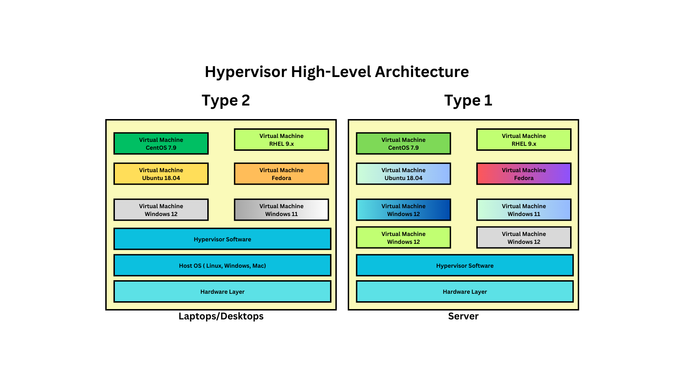

# Day 1

## Info - Hypervisor Overview
<pre>
- Hypervisor is nothing but Virtualization
- Virtualization helps us run multiple OS on your laptop/desktop/workstation/server
- i.e more than 1 OS can run side-by-side on your machine
- there are 2 types of Hypervisors
  1. Type 1 - a.k.a Bare Metal Hypervisors
     - is used in Servers & Workstations
     - near native-hardware performance
     - examples
       - KVM ( supported in all Linux distributions, free & opensource )
       - VMWare vSphere(vCenter)
       - Microsoft Hyper-V
       
  2. Type 2 - a.k.a Hosted Hypervisors
     - is used in Laptops/Desktops & Workstations
     - slightly slower
     - examples
       - Oracle VirtualBox ( Free - Supports Windows, Linux & Mac )
       - VMWare Workstation ( Free - Supports Windows & Linux )
       - VMWare Fusion ( Supports only Mac and requires a commercial license )
       - Parallels ( Supports only Mac and requires a commercial license )
- each OS that runs on top Hypervisor is called a Guest OS
- Guest OS requires it own Virtual Machine (VM)
- each Virtual Machine must be allocated with dedicated Hardware resources
  - CPU Cores ( Actual )
  - RAM ( Actual )
  - Storage ( Actual )
  - Network Card ( Virtual )
  - Graphics Card ( Virtual )
- Because every VM requires dedicated H/w resources, this type of Virtualization is called heavy-weight
</pre>

## Info - Processors
<pre>
- Modern Processors generally supports multiple CPU Cores
- each Processor may host 2/4/8/16/32/64/128/256 Cores
- In motherboard, the Processors sockets supports two type of packaging
  1. SCM ( Single Chip Module )
     - the Integrated Circuit has 1 Processor in it
  2. MCM ( Multi Chip Module )
     - the Integrated Circuit has more than 1 Processor in it
- Generally Server Motherboards supports multiple Processor Sockets
  - In 2012, I have Server motherboard with 8 Processor Sockets
  - Assume if we install a MCM IC with 2 Processors ( each Processor having 128 CPU Cores )
  - Total Physical CPU Cores = 8 x 2 x 128 = 2048 CPU Cores
  - AMD supports 2 logical core per Physical CPU - it is called SMT
  - Intel also supports 2 logical core per Physical CPU - it is called Hyperthreading
  - Logical/Virtual CPU Core in total = 2 x 2048 = 4096 Cores
  - easily the server can host 1024 Virtual Machine - each VM allocated with 4 CPU Cores 
- each VM, represents one fully function Operating System with its own OS Kernel, hardware resources, etc.,
</pre>

# Info - Hypervisor High-Level Architecture


## Info - Containerization
<pre>
- Containerization is a light-weight application virtualization technology
- each Container represents one application process in the Operating System
- in some cases, more than container put together represents a single application
- even in a laptop/desktop with regular/decent hardware configuration, we can easily run 10~20 containers
- firewall/proxy, creating different networks can all be done with software, hence with containers
  we could simulate many complex scenarios just like how they would run in production, hence many issues
  could be caught during dev/qa cycle itself
- this is a linux technology
  - Linux kernel has 2 features
    1. Namespace and
       - helps in isolating one container from the other container
    2. Control Group
      - helps in applying container level resource quota restrictions
        - For instance, we can control, 
          - how much/many CPU Core one container can access at the max
          - how much store one container can access at the max
- Container Runtime
  - examples
    - cRun
    - runC
    - CRI-O
- Container Engine
  - examples
    - Docker
    - Podman
</pre>

## Info - Container Runtime
<pre>
- is a low-level software that helps us manage Container images and Containers
- it is not so user-friendly, hence the end-user don't use this directly
</pre>

## Info - Container Engine
<pre>
- Container Engines are high-level software that helps us manage Container images and Containers
  without knowing low-level Linux Kernel Container features
- it provides user-friendly commands to manage images and containers
- it depends on Container Runtimes to manage Images and Containers
- examples
  - Docker Container Engine depends on containerd interface which in-turn depends on runC Container Runtime
  - Podman Container Engine depends on CRI-O Container Runtime
</pre>

## Info - Docker High-Level Architecture


## Lab - Finding docker version details
```
docker --version
docker info
```


## Lab - Listing all docker images in your Docker Local Registry
```
docker images
```


