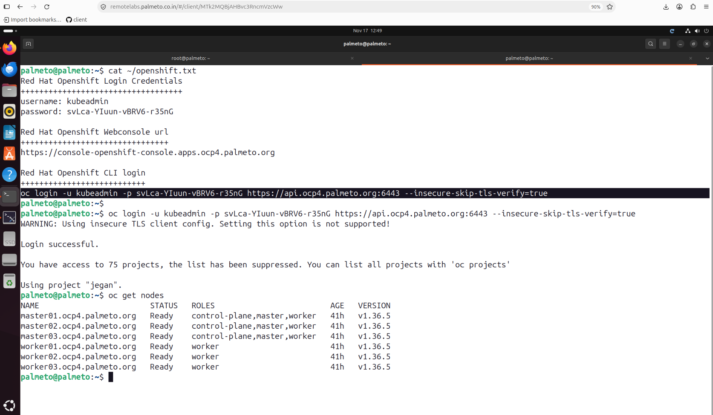
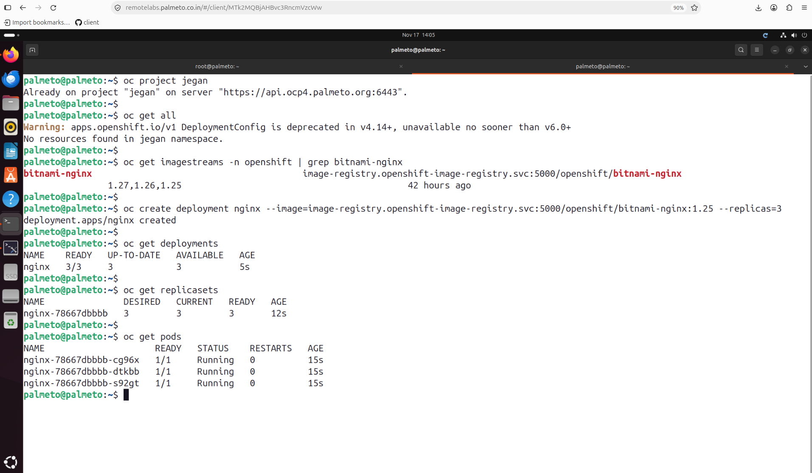
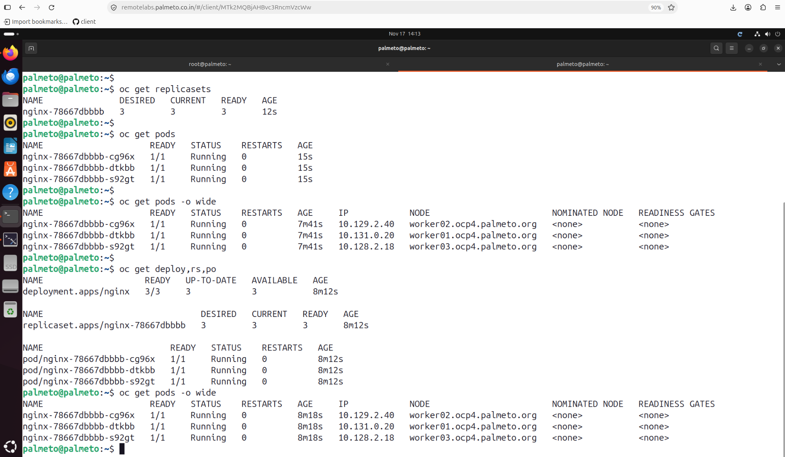

# Day 2

## Info - Container Orchestration Platform
<pre>
- They provide all the essentials features required to make your application highly available (HA)
- it provides in-built load-balancing
- it provides in-built service abstraction
- it provides in-built Service Discovery
- it provides in-built scale up/down feature
- it provides rolling update feature
  - with this we can upgrade our application from one version to other without downtime
- it provides in-built application monitoring features
- it provides features to self-heal your applications
- it provides features to make your application access only locally or externally
- examples
  - Docker SWARM
  - Kubernetes
  - Red Hat Openshift
  - Rancher
</pre>

## Info - Docker SWARM
<pre>
- this is Docker Inc native Container Orchestration Platform
- it supports only Docker containerized application workloads
- Docker SWARM works as cluster of many machines
- Some of those machines acts as a master and some of them act as a slave/worker 
- Applications can be deployed with the help of Docker Images
- In order to deploy your application into Docker SWARM, you need a create a Custom Docker Image
  that has your application and all your application dependencies
- With that custom image, we can deploy our application into Docker SWARM
- it is very easy to setup Docker SWARM on a laptop with very average hardware configuration also
- it is easy to install, easy to learn 
- it is an ideal setup of dev & QA
- it is not a production-grade Container Orchestration Platform
- hence, it is almost never used in production
- we will struck with only Docker, as it won't support other type of Containers
</pre>

## Info - Kubernetes
<pre>
- it is a Container Orchestration Platform developed by Google
- originally it was developed and used within Google as Borg
- Kubernetes is developed in Golang
- After using Borg in several complex projects internally, Google refactored, improved it and made it as a opensource tool
  as Kubernetes
- it is a robust, opensource, production-grade Container Orchestration Platform
- it is command-line only
- it works as a cluster ( group of many servers )
- these servers are classified as master and worker
- there can several masters and worker nodes (servers)
- Master Nodes
  - only the master nodes runs the Control Plane Components
  - on need-basis, this node can be configured to allow deploying user applications as well
- Worker Nodes
  - this is where user applications will be running
- on Master and Worker Node, we can any Linux OS of our choice
- Every Node i.e Master and Worker node, we need to install the Container Runtimes we prefer use in the cluster wide
- Kubernetes supports many different types of Container runtimes and Container Engines
- applications are deploy as Pod
- Pod is the smallest unit we can deploy into Kubernetes
- Kubernetes is also called in short as K8s
- it provides all the basic boilerplate features required to extend Kubernetes
  - For instance
    - it supports adding a new type of Resource in Kubernetes by defining a Custom Resource Definition (CRD) in a yaml file
    - to manage custom resources, we also need to provide a custom controller
    - the combination of one or more Custom Resources and one or more Controllers is called Kubernetes Operator
    - this is way we can extend Kubernetes API ( features )
</pre>

## Info - Red Hat Openshift
<pre>
- it is Red Hat's distribution of Kubernetes
- Openshift supports everything that Kubernetes support + many addition features
- it is developed on top of opensource Kubernetes
- it supports both CLI and Webconsole
- it supports User Management
  - hence Role Based Access Control is possible
- it supports deploying applications
  - from Container Image just like Kubernetes
  - as well from source code, it is called S2I (Source to Image)
- it supports features like
  - Webconsole
  - User Management
  - Build
  - BuildConfig
  - Route
  - Project
  - ImageStream
  - Internal Container Registry
- as it is an enterprise product that requires license, it also comes with world-wide support from 
  Red Hat ( an IBM company )
</pre>

## Info - Types of applications that can be deployed in Kubernetes/Openshift
<pre>
- Stateless application
- Stateful applications
- One time application ( Job )
- Recurring application ( CronJob )
- Application that runs in every node ( DaemonSet )
</pre>

## Info - Kubernetes/Openshift Jargons ( terms or resource types )
<pre>
- Pod
- ReplicaSet
- Deployment
- StatefulSet
- DaemonSet
- Job
- CronJob
- Service
- Ingress
- Route
- ImageStream
- Project
</pre>

## Info - Pod
<pre>
- Pod is a logical grouping of related containers
- this is applications will be running as a container
- each Pod may have one or more Containers in it
- IP Address is assigned on the Pod level ( not on the container level )
</pre>

## Info - ReplicaSet
<pre>
- In case of Stateless applications, Kubernetes/Openshift makes use of ReplicaSet configuration object resource
  to capture details like
  - The container image that must be used to deploy your application
  - number of instances of your applications that must be running
- ReplicaSet configuration is taken as an input by a Controlled called ReplicaSet Controller
- ReplicaSet are created by Deployment Controller, while ReplicaSet controller acts based on ReplicaSet definition
- ReplicaSet Controller comes to know whenever a ReplicaSet changes by way of event notifications
</pre>

## Info - Deployment
<pre>
- in case of Stateless applications, Kubernetes/Openshift makes use of Deployment to represent the Stateless application
- this resource captures the details below
  - name of the application
  - container image that must be used to deploy the application
  - expected number of application instances ( Pods ) 
- Deployment Controller takes Deployment Configuration object as input and acts
- Deployment Controller comes to know about changes done to the Deployment by way of event notifications
</pre>

## Info - StatefulSet
<pre>
- this is used to deploy stateful applications
- managing this kind of applications is more complicated and tricky compared to stateless application
- Kubernetes/Openshift provide the basic StatefulSet type of resource to indicate it is a stateful application
  but otherwise, making the Pods instances work like a cluster is our responsibility
- examples
  - we need to deploy a cluster of mysql database servers
  - when one mysql pod instance is updated with some data, the other mysql instances
    automatically gets synchronized with the updated data
</pre>

## Info - Job
<pre>
- the application runs as a Pod for few second/minutes and marks as Complete
- this is meant to be use for any one-time activity
- example
  - you need to take backup of data
</pre>

## Info - CronJob
<pre>
- for any recurring activity, this is used
- example
  - let's say we would like to take backup every Friday, midnight
</pre>


## Info - Service
<pre>
- applications are going to run as Pod
- Pods are considered ephemeral ( temporary ), they come and go 
- Service represents a group of load-balance pods
- Service gets a stable name and IP address, which will never change unless we changed it
- hence, we can reliably use service while interacting with Pods
- one Pod is not supposed to interact with other Pod directly, they must communicate via a Service
- there are broadly classified as
  1. Internal Service
     - ClusterIP Service
  2. External Service
     - NodePort Service
     - LoadBalancer Service
</pre>

## Info - Project
<pre>
- Openshift created Project based Kubernetes namespace features
- If a team would like deploy one or more applications that only their team members should access, 
  that's where Project comes in handy
- through Project, we can control who gets access to an application
- it is a way one team can segregate their application from other teams application deployments
</pre>

## Info - Kubernetes/Openshift Master Node
<pre>
- Control Plane components will run only in the master node (Linux Server) 
- Control Plane is the heart/brain of Container Orchestration Platform
- What are the components in Control Plane
  1. API Server
  2. etcd key/value distributed datastore
  3. Scheduler
  4. Controller Managers ( a collection of many Controller )
- In case of Kubernetes/Rancher, the master nodes are allowed to install any Linux OS
- In case of Openshift, the master nodes should install only Red Hat Enterprise CoreOS ( RHCOS )
- RHCOS
  - is a optimized, secured, minimal Linux
  - it has only those linux tools required for Container Orchestration Platform
  - it comes with CRI-O Container Runtime and Podman Container Engine pre-install
  - each version of RHCOS, comes with one specific version of CRI-O and Podman
  - enforces best-practices are followed
  - it restricts ports below 1024, as they are reserved for internal use in Openshift 
  - it won't allow running applications with root user/access
  - only root-less container images are allowed for normal user applications
</pre>

## Info - Kubernetes/Openshift Worker Node
<pre>
- Kubernetes/Rancher allows installing any Linux OS on worker nodes
- Openshift allows installing either
  1. Red Hat Enterprise Linux ( RHEL )  or
  2. Red Hat Enterprise Core OS ( RHCOS ) - Recommended
- When we install RHCOS in master and worker nodes, using oc command, we can upgrade a cluster
</pre>

## Info - Kubernetes/Openshift tools
<pre>
kubectl - kubernetes client tool
kubeadm - kubernetes admin tool
oc - openshift client
   - this combines the admin kubeadm and kubectl 
</pre>

## Lab - Login to Openshift from linux command line
```
cat ~/openshift.txt
# Server 1
oc login -u kubeadmin -p AR3IT-vpADW-fPNeV-pfTxP https://api.ocp4.palmeto.org:6443 --insecure-skip-tls-verify=true

# Server 2
oc login -u kubeadmin -p svLca-YIuun-vBRV6-r35nG https://api.ocp4.palmeto.org:6443 --insecure-skip-tls-verify=true

kubectl version
oc version
oc get nodes
```


## Lab - Finding details of a node ( Only Openshift administrators can run this - it work in our lab but not in your bank as a developer )
```
oc describe node/master01.ocp4.palmeto.org
oc describe node/master02.ocp4.palmeto.org
oc describe node/master03.ocp4.palmeto.org

oc describe node/worker01.ocp4.palmeto.org
oc describe node/worker02.ocp4.palmeto.org
oc describe node/worker03.ocp4.palmeto.org
```

## Lab - Listing all namespaces/projects
```
# Plural
oc get namespaces
# Singular
oc get namespace
# Short-form
oc get ns

oc get projects
oc get project
```

## Lab - Creating a project
```
oc new-project jegan
```

## Lab - Switching between projects
```
oc project default
oc project jegan
```

## Lab - Finding your current active project
```
oc project
```

## Lab - Deploying your first stateless application into Openshift
```
# Switch to your project
oc project jegan

# Deploy nginx 
oc create deployment nginx --image=image-registry.openshift-image-registry.svc:5000/openshift/bitnami-nginx:1.25 --replicas=3

# List deployments
oc get deployments
oc get deployment
oc get deploy

# List replicasets
oc get replicasets
oc get replicaset
oc get rs

# List pods
oc get pods
oc get pod
oc get pod

# List all
oc get all
oc get deploy,rs,po

oc get pods -o wide
```


