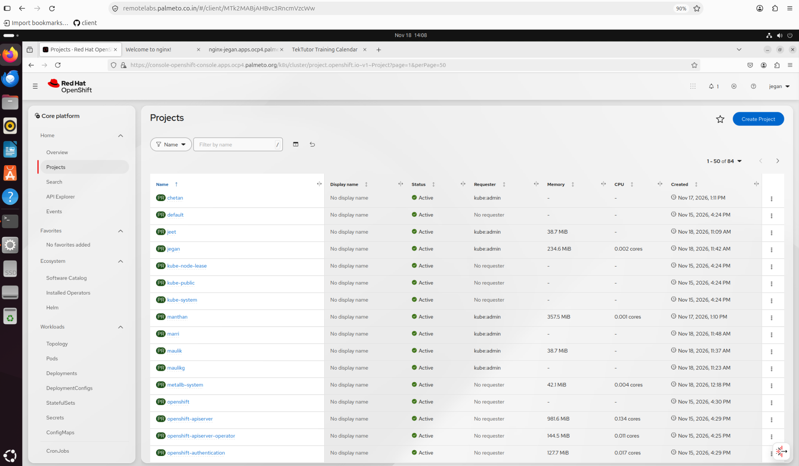
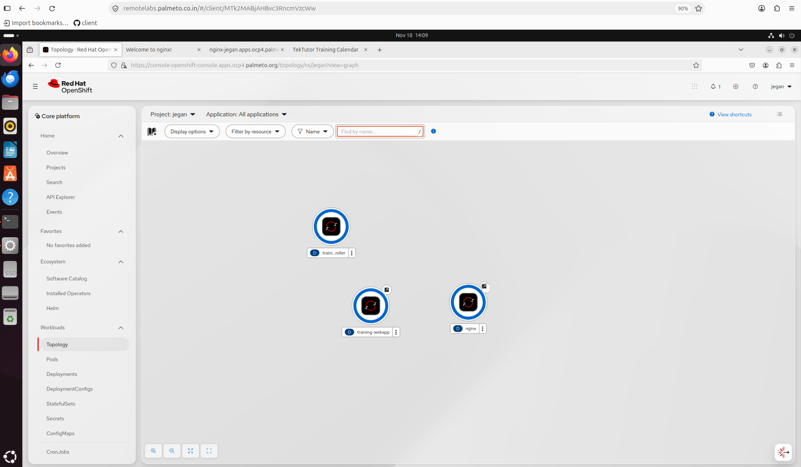
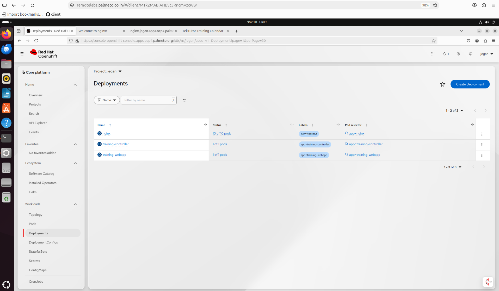
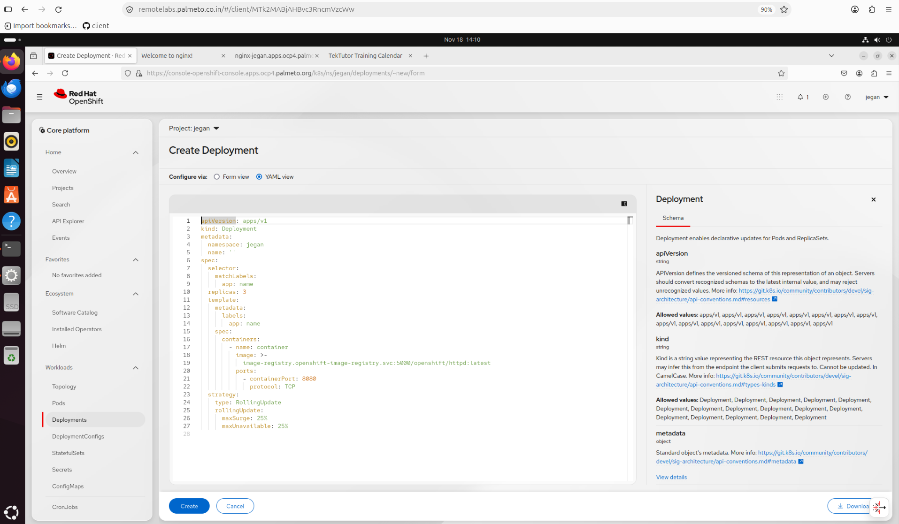
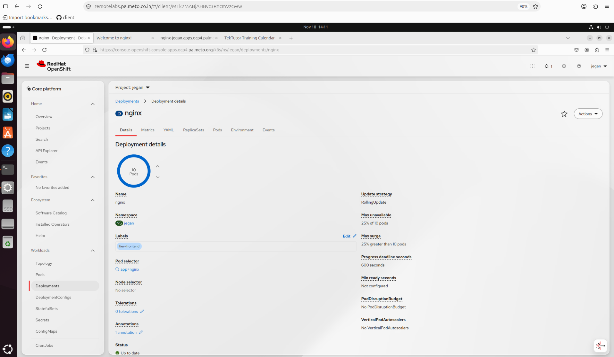
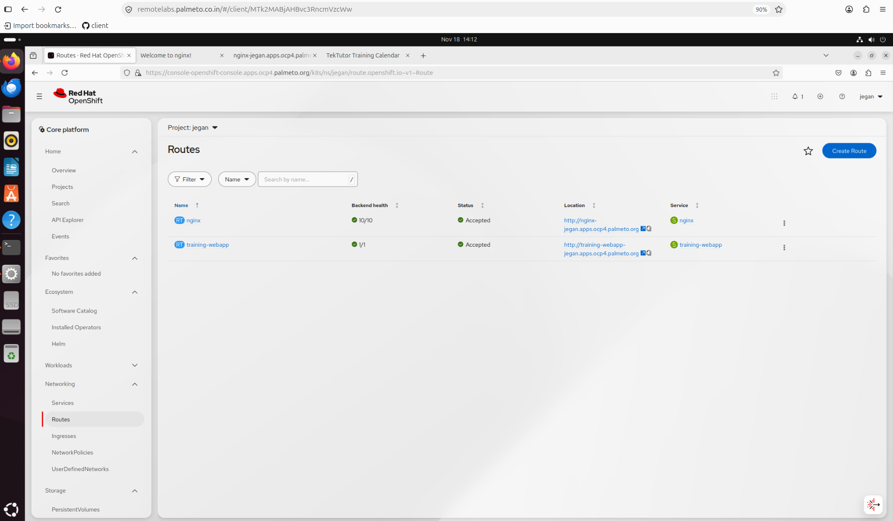
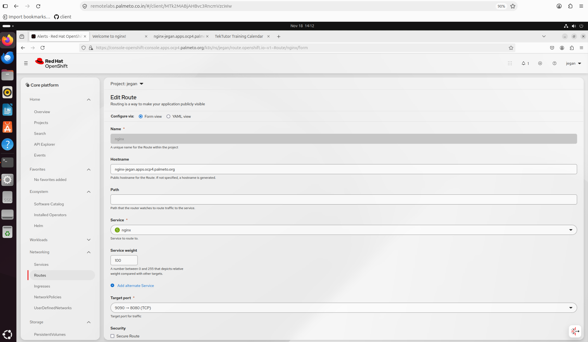
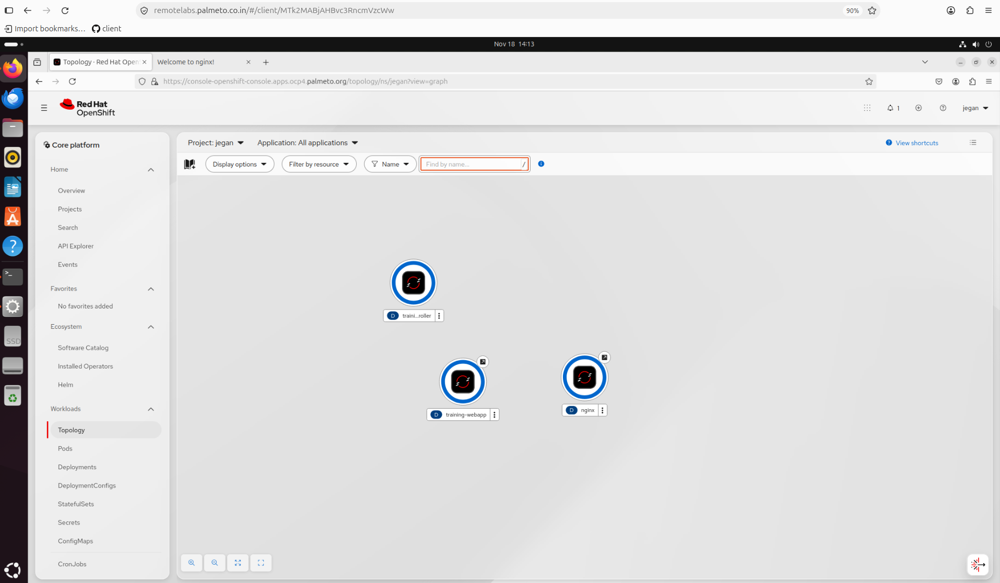

# Day 3

## Lab - Declaratively deploying application into Openshift
```
# Delete your existing project
oc delete project jegan

# Create a new project
oc new-project jegan

# Auto-generate declarative code to deploy nginx declaratively
oc create deploy nginx --image=image-registry.openshift-image-registry.svc:5000/openshift/bitnami-nginx:1.25 --replicas=3 --dry-run=client -o yaml

# Redirect the yaml output to a yaml file
oc create deploy nginx --image=image-registry.openshift-image-registry.svc:5000/openshift/bitnami-nginx:1.25 --replicas=3 --dry-run=client -o yaml > nginx-deploy.yml

cat nginx-deploy.yml

# Declaratively deploy the nginx into Openshift
oc create -f nginx-deploy.yml --save-config=true

# List and check
oc get deploy,rs,po

```

## Lab - Declaratively create a ClusterIP Internal Service
```
oc project jegan
oc get deploy

# Declaratively create ClusterIP Internal service
oc expose deploy/nginx --type=ClusterIP --port=8080 --dry-run=client -o yaml
oc expose deploy/nginx --type=ClusterIP --port=8080 --dry-run=client -o yaml > nginx-clusterip-svc.yml

# Create internal service declaratively
oc create -f nginx-clusterip-svc.yml --save-config=true

oc get svc
oc describe svc/nginx
```

## Lab - Using Openshift Webconsole
```
cat ~/openshift.txt

oc whoami --show-console


# Open the below url in firefox browser on your Ubuntu Cloud machine
https://console-openshift-console.apps.ocp4.palmeto.org
```













## Info - LoadBalancer Service
<pre>
- LoadBalancer service is an external service supported in Kubernetes & Openshift
- LoadBalancer service is generally used in managed Kubernetes/Openshift in public cloud like AWS eks/ROSA, Azure AKS/ARO, etc.,
- When a LoadBalancer service is created in AWS, it will spin up an ALB (Application Load Balancer) in AWS, the AWS ALB will perform
  load balancing for our application pods running in AWS eks/ROSA
- When a LoadBalancer is created, it also get an public static IP, which is accessible over Internet
- For each ALB created in AWS, there will be an extra on a monthly basis as it is not part of Kubernetes/Openshift managed cluster
- When we attempt to create a LoadBalancer service in a on-prem local Kubernetes/Openshift cluster, we don't have an equivalent of ALB
  on our local setup, hence the loadbalancer service will never get an external IP
- In order to get an get external IP and configure a LoadBalancer similar to ALB in our local setup, we can use use MetalLB operator to
  support LoadBalancer on a local openshift/kubernetes cluster
</pre>

## Lab - Creating a LoadBalancer service declaratively
```
oc project jegan

oc get deploy
oc delete svc/nginx

oc expose deploy/nginx --type=LoadBalancer --port=8080 --dry-run=client -o yaml
oc expose deploy/nginx --type=LoadBalancer --port=8080 --dry-run=client -o yaml > nginx-lb-svc.yml

oc apply -f nginx-lb-svc.yml

oc get svc
oc describe svc/nginx

curl http://192.168.100.50:8080
```
