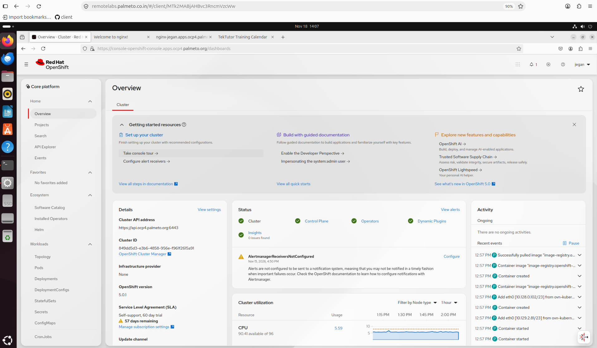
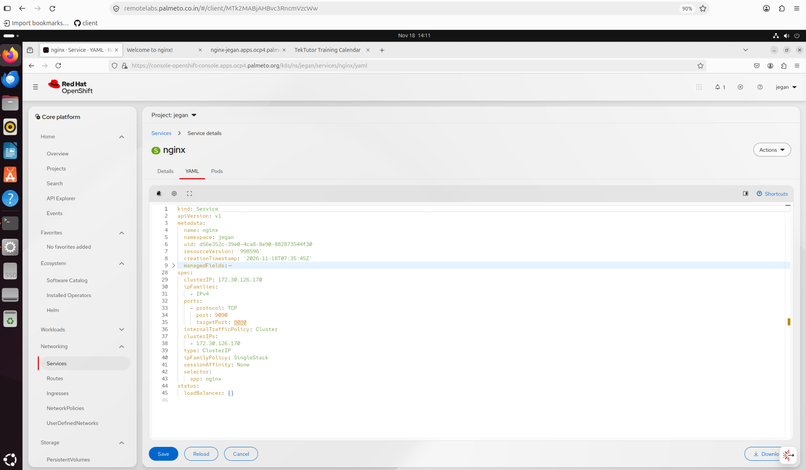
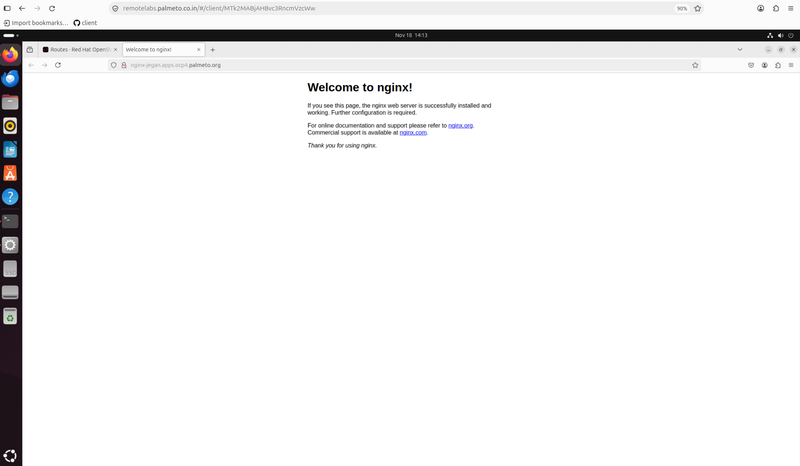

# Day 3

## Lab - Declaratively deploying application into Openshift
```
# Delete your existing project
oc delete project jegan

# Create a new project
oc new-project jegan

# Auto-generate declarative code to deploy nginx declaratively
oc create deploy nginx --image=image-registry.openshift-image-registry.svc:5000/openshift/bitnami-nginx:1.25 --replicas=3 --dry-run=client -o yaml

# Redirect the yaml output to a yaml file
oc create deploy nginx --image=image-registry.openshift-image-registry.svc:5000/openshift/bitnami-nginx:1.25 --replicas=3 --dry-run=client -o yaml > nginx-deploy.yml

cat nginx-deploy.yml

# Declaratively deploy the nginx into Openshift
oc create -f nginx-deploy.yml --save-config=true

# List and check
oc get deploy,rs,po

```

## Lab - Declaratively create a ClusterIP Internal Service
```
oc project jegan
oc get deploy

# Declaratively create ClusterIP Internal service
oc expose deploy/nginx --type=ClusterIP --port=8080 --dry-run=client -o yaml
oc expose deploy/nginx --type=ClusterIP --port=8080 --dry-run=client -o yaml > nginx-clusterip-svc.yml

# Create internal service declaratively
oc create -f nginx-clusterip-svc.yml --save-config=true

oc get svc
oc describe svc/nginx
```

## Lab - Using Openshift Webconsole
```
cat ~/openshift.txt

oc whoami --show-console


# Open the below url in firefox browser on your Ubuntu Cloud machine
https://console-openshift-console.apps.ocp4.palmeto.org
```








## Info - LoadBalancer Service
<pre>
- LoadBalancer service is an external service supported in Kubernetes & Openshift
- LoadBalancer service is generally used in managed Kubernetes/Openshift in public cloud like AWS eks/ROSA, Azure AKS/ARO, etc.,
- When a LoadBalancer service is created in AWS, it will spin up an ALB (Application Load Balancer) in AWS, the AWS ALB will perform
  load balancing for our application pods running in AWS eks/ROSA
- When a LoadBalancer is created, it also get an public static IP, which is accessible over Internet
- For each ALB created in AWS, there will be an extra on a monthly basis as it is not part of Kubernetes/Openshift managed cluster
- When we attempt to create a LoadBalancer service in a on-prem local Kubernetes/Openshift cluster, we don't have an equivalent of ALB
  on our local setup, hence the loadbalancer service will never get an external IP
- In order to get an get external IP and configure a LoadBalancer similar to ALB in our local setup, we can use use MetalLB operator to
  support LoadBalancer on a local openshift/kubernetes cluster
</pre>

## Lab - Creating a LoadBalancer service declaratively
```
oc project jegan

oc get deploy
oc delete svc/nginx

oc expose deploy/nginx --type=LoadBalancer --port=8080 --dry-run=client -o yaml
oc expose deploy/nginx --type=LoadBalancer --port=8080 --dry-run=client -o yaml > nginx-lb-svc.yml

oc apply -f nginx-lb-svc.yml

oc get svc
oc describe svc/nginx

curl http://192.168.100.50:8080
```

## Lab - Pod auto-scaling
Clone the TekTutor Training Repository if you haven't done it already
```
cd ~
git clone https://github.com/tektutor/openshift-nov-2026.git
cd openshift-nov-2026
cd Day3/auto-scaling
oc project jegan
oc apply -f hello-deploy.yml
oc apply -f hello-hpa.yml
oc expose deploy/nginx --port=8080
oc expose svc/nginx 

oc get hpa
oc get pods

# Terminal window 1
ab -n 250000 -c 200 http://nginx-jegan1.apps.ocp4.palmeto.org/

# Terminal window 2
oc get pods -w
```

## Info - Persistent Volume (PV)
<pre>
- it is an external storage used by application Pods in Kubernetes/Openshift/Rancher/eks/aks/ROSA
- it is created by Openshift Administrators either manually/dynamically
- In order to create the PV dynamically, the Administrators has to a StorageClass
- AWS StorageClass will have login credentials for AWS, to create S3 buckets
- NFS StorageClass it know how to export a folder in NFS server
- The advantage of dynamic PV provisioning is that, whenever any application is requesting
  for external PV storage, the StorageClass will automatically create it and let your
  application use that storage
- The static/manual provisioning of PV requires, raising a ticket to your IT team, the IT
  team will create a PV for your project 
</pre>

## Info - Persistent Volume Claim (PVC)
<pre>
- any Pod that needs external storage has to ask to for it explicitly by creating a PVC
- PVC will say
  - how much disk space your application needs in MB/GB/TB
  - Access permissions like ReadWriteOnce, ReadWriteMany, etc.,
  - Do you expect the storage to come from any specific AWS S3, NFS by mentioning the storageclass name
- Storage Controller will scan the cluster for a matching PV
  - matching PV for PVC will have
    - the exact storage capacity (size)
    - exact access permissions
    - storageclass ( if PV has mentioned it )
  - if there is a matching PV found, then the PVC will be allowed to go and bound/claim it and use it
</pre>

## Lab - Deploying multi-pod wordpress and mysql application
```
cd ~/openshift-nov-2026
git pull
cd Day3/wordpress-with-configmaps-and-secrets/
sed -i 's/jegan/your-linux-username/g' *.yml

# Check your NFS path reserved for your wordpress and mysql deployments
showmount -e localhost | grep your-linux-username

oc project jegan1
./deploy.sh

oc get pv,pc
oc get pods
oc get route

oc logs mysql-6dbc55856c-8xkwp
oc logs wordpress-b796676bf-dnpw9


```
