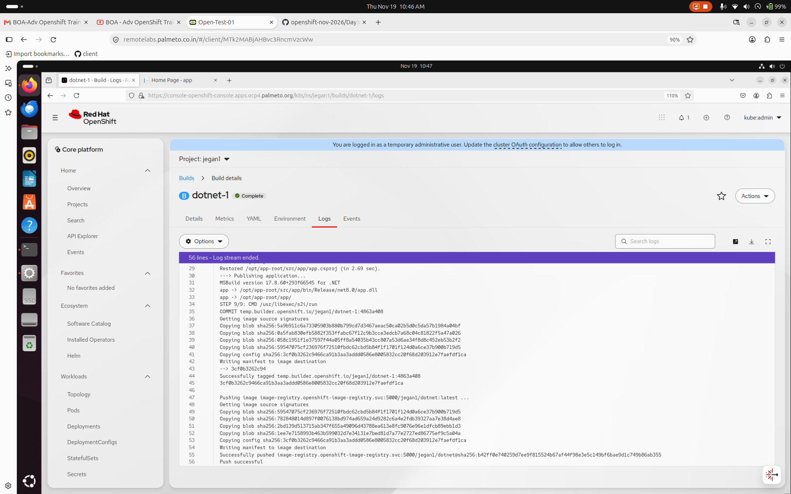

# Day 4

## Info - S2I Overview
<pre>
- S2I stands for Source to Image
- Deploying application into Openshift using source code from any version control
- There are many deployment strategies
  - docker
  - source
  - pipeline
  - custom
</pre>

## Info - S2I Source strategy
<pre>
- Red Hat has many Universal Base Images (UBI) for every programming language stack
</pre>

## Lab - Deploying Dot Net Application into Openshift





## Lab - Deploying Java SpringBoot Microservice using S2I Docker Strategy
```
oc new-project jegan1
oc new-app --name=hello https://github.com/tektutor/spring-ms.git --strategy=docker
oc expose svc/hello

oc logs -f bc/hello
oc get route
curl http://hello-jegan1.apps.ocp4.palemeto.org
```

## Lab - Deploying Java SpringBoot Microservice using S2I Source Strategy
```
oc delete project jegan1

oc new-project jegan1
oc new-app --name=hello registry.access.redhat.com/ubi8/openjdk-17~https://github.com/tektutor/spring-ms.git --strategy=source
oc expose svc/hello

oc logs -f bc/hello
oc get route
curl http://hello-jegan1.apps.ocp4.palemeto.org
```

## Lab - Building SpringBoot application from TekTutor Code Repository and deploying the application into Openshift
```
oc new-project jegan1
cd ~/openshift-nov-2026
git pull
cd Day4/S2I
oc apply -f chained-s2i-auto-deploy.yaml

oc get buildconfigs
oc logs -f buildconfig/app-maven-builder
oc logs -f buildconfig/app-runtime

oc get deploy,svc,route
# From Webconsole clicke the app-runtime route url ( click the up arrow in Topology view under your project )
```

## Info - Helm Overview
<pre>
- it is a package manager for Kubernetes and Openshift applications
- We can package our Openshift applications as Helm Chart ( compressed file that follows a particular directory structure )
- Through help, we deploy/undeploy application into Kubernetes & Openshift
- Helm, depends on Kubeconfig file just like oc/kubectl
- Helm is aware of all Kubernetes & Openshift resource types, hence it knows in which sequence the resources must be deployed
  into Openshift/Kubernetes
- Helm tool comes pre-integrated with Openshift
</pre>

## Lab - Deploying wordpress and mysql using our custom helm chart
```
cd ~
mkdir wordpress-helm-chart
cd wordpress-helm-char
helm create wordpress
cd wordpress/templates
rm -rf *
cp ~/openshift-nov-2026/Day3/wordpress-with-configmaps-and-secrets/*.yml .

cd ../..
helm package wordpress
helm list
helm install wordpress wordpress-0.1.0.tgz
helm list
oc get pods

# Head over to your Openshift webconsole and access the wordpress your route on the topology page

# Once you are done with this exercise, you may delete it
helm uninstall wordpress
```
