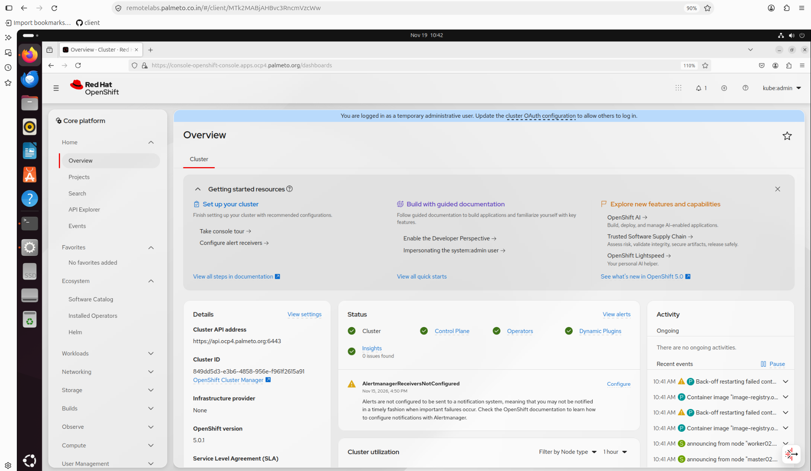
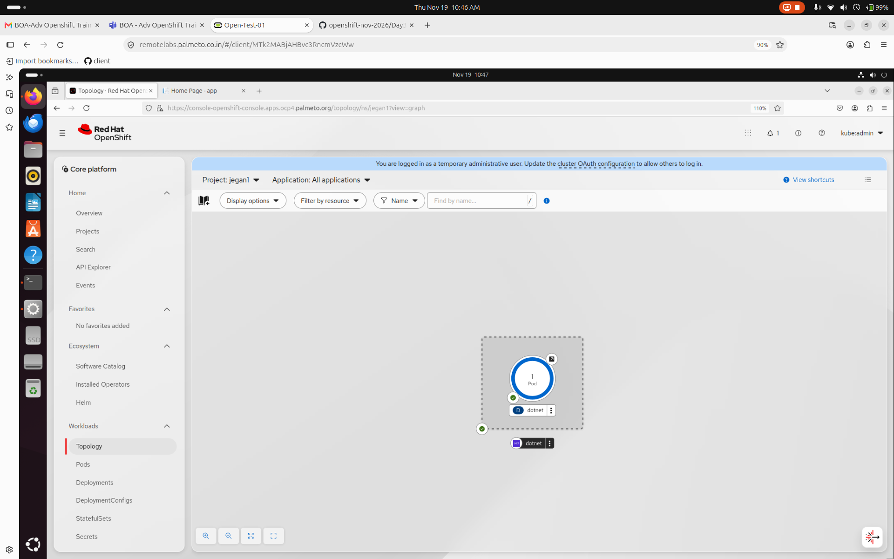

# Day 4

## Info - S2I Overview
<pre>
- S2I stands for Source to Image
- Deploying application into Openshift using source code from any version control
- There are many deployment strategies
  - docker
  - source
  - pipeline
  - custom
</pre>

## Info - S2I Source strategy
<pre>
- Red Hat has many Universal Base Images (UBI) for every programming language stack
</pre>

## Lab - Deploying Dot Net Application into Openshift





## Lab - Deploying Java SpringBoot Microservice using S2I Docker Strategy
```
oc new-project jegan1
oc new-app --name=hello https://github.com/tektutor/spring-ms.git --strategy=docker
oc expose svc/hello

oc logs -f bc/hello
oc get route
curl http://registry.access.redhat.com/ubi8/openjdk-17-runtime:latest
```
