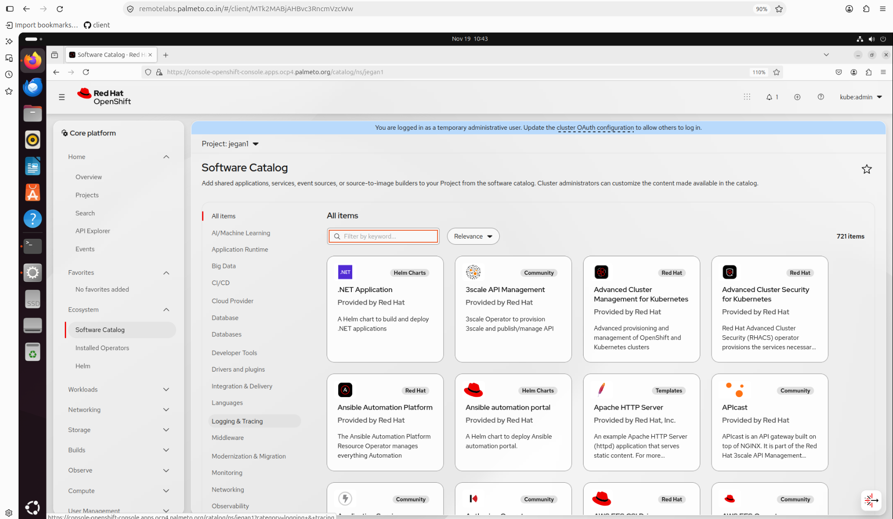
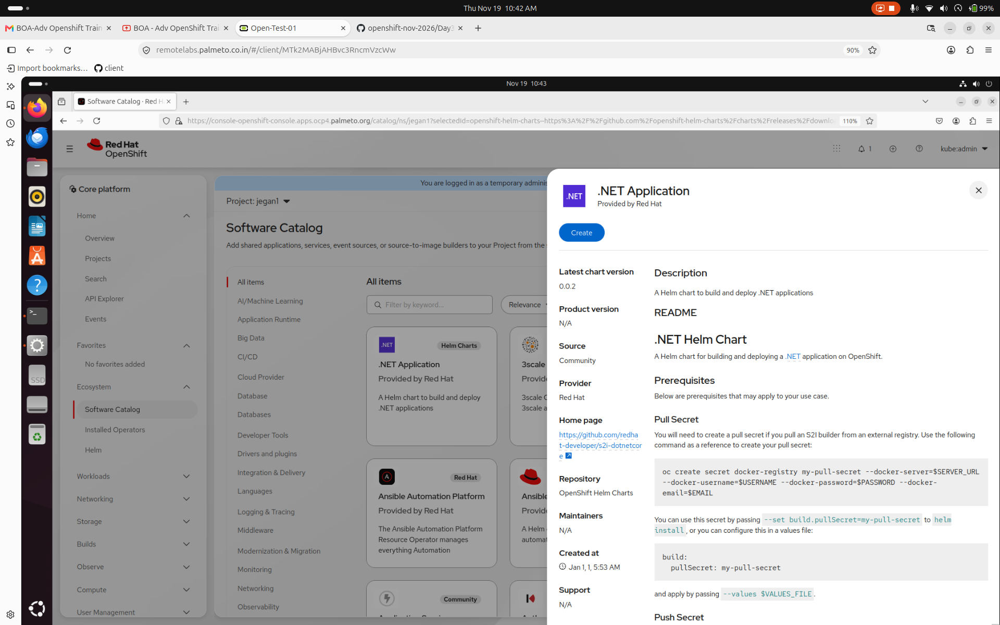
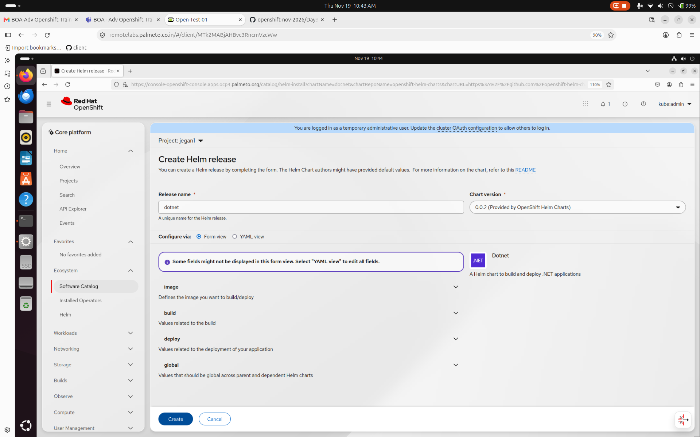

# Day 4

## Info - S2I Overview
<pre>
- S2I stands for Source to Image
- Deploying application into Openshift using source code from any version control
- There are many deployment strategies
  - docker
  - source
  - pipeline
  - custom
</pre>

## Info - S2I Source strategy
<pre>
- Red Hat has many Universal Base Images (UBI) for every programming language stack
</pre>

## Lab - Deploying Dot Net Application into Openshift






## Lab - Deploying Java SpringBoot Microservice using S2I Docker Strategy
```
oc new-project jegan1
oc new-app --name=hello https://github.com/tektutor/spring-ms.git --strategy=docker
oc expose svc/hello

oc logs -f bc/hello
oc get route
curl http://hello-jegan1.apps.ocp4.palemeto.org
```

## Lab - Deploying Java SpringBoot Microservice using S2I Source Strategy
```
oc delete project jegan1

oc new-project jegan1
oc new-app --name=hello https://github.com/tektutor/spring-ms.git --strategy=source
oc expose svc/hello

oc logs -f bc/hello
oc get route
curl http://hello-jegan1.apps.ocp4.palemeto.org

```

## Lab - Building SpringBoot application from TekTutor Code Repository and deploying the application into Openshift
```
oc new-project jegan1
cd ~/openshift-nov-2026
git pull
cd Day4/S2I
oc apply -f chained-s2i-auto-deploy.yaml

oc get buildconfigs
oc logs -f buildconfig/app-maven-builder
oc logs -f buildconfig/app-runtime

oc get deploy,svc,route
# From Webconsole clicke the app-runtime route url ( click the up arrow in Topology view under your project )
```
