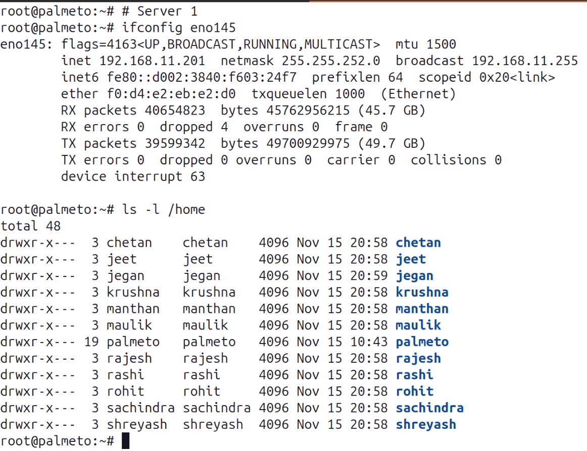

# Red Hat Openshift 16-20 November 2026

## Info - Break Timings
<pre>
- First Half Tea break : 11:15 to 11:30 am
- Lunch break : 1:15 to 2 pm
- Second Half Tea break: 4:15 to 4:30 pm
- Session end by : 6 pm
</pre>

## Info - Cloud Lab Login credentials
<pre>
- You would have received an email from your L&D focal point recently
- Make sure you are not connecting to the demo link
- There are 2 levels of login authentication in order to connect to your lab machine
  1. Cloud login ( you can retrieve login credentials from your email from L&D team )
  2. Ubuntu Login credentials ( username will be your firstname or lastname, password is palmeto@123 for all participants )
     - Your ubuntu login can be found from the Server1 or Server2 screenshots below
</pre>

## About about lab environment
<pre>
We have got two servers with below configurations
- Dell PowerEdge R840 Server
- Intel Xeon Processor with 192 CPU Cores 
- 1 TB RAM
- 21 TB SSD
</pre>

 
