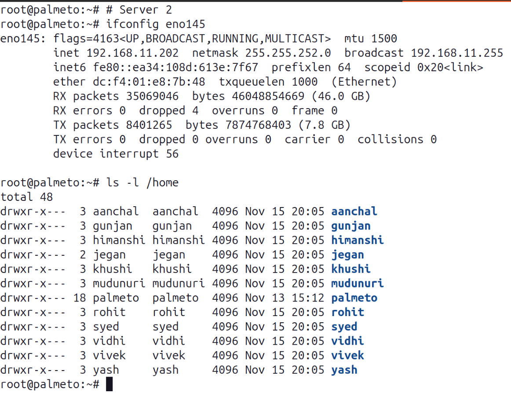
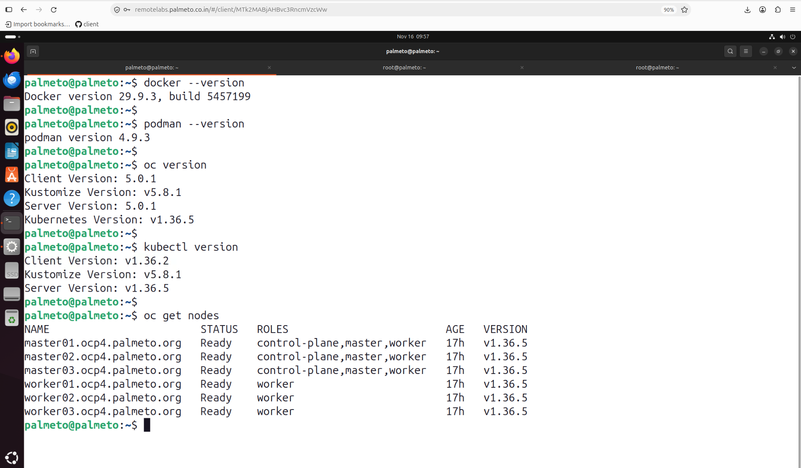

# Red Hat Openshift 16-20 November 2026

## Info - Contact Palmeto for any Lab connectivity issues
<pre>
- Kindly leave a message to Training01 user in the chat 
- In case Chat is disabled for you, you may directly call Palmeto IT Team @ +91 636-618-1818
- In case of no/delay in response, you may inform the trainer
</pre>

## Info - Break Timings
<pre>
- First Half Tea break : 11:15 to 11:30 am
- Lunch break : 1:15 to 2 pm
- Second Half Tea break: 4:15 to 4:30 pm
- Session end by : 6 pm
</pre>

## Info - Cloud Lab Login credentials
<pre>
- You would have received an email from your L&D focal point recently
- Make sure you are not connecting to the demo link
- There are 2 levels of login authentication in order to connect to your lab machine
  1. Cloud login ( you can retrieve login credentials from your email from L&D team )
  2. Ubuntu Login credentials ( username will be your firstname or lastname, password is palmeto@123 for all participants )
     - Your ubuntu login can be found from the Server1 or Server2 screenshots below
</pre>

## About about lab environment
<pre>
We have got two servers with below configurations
- Dell PowerEdge R840 Server
- Intel Xeon Processor with 192 CPU Cores 
- 1 TB RAM
- 21 TB SSD
</pre>


 


## Info - Check if you lab machine has all the tools required ( Try it in Ubuntu Terminal ) 
```
docker --version
podman --version

docker images
podman images

kubectl version
oc version

# Only Openshift administrators can run this - it work in our lab but not in your bank as a developer
oc get nodes
oc get nodes -o wide
```


## Info - Kindly complete the pre-test from Cloud lab machine and confirm in the chat
```
https://forms.cloud.microsoft/r/qUeUxwrQcp
```

Note
<pre>
- While registering for the training, type your full firstname and lastname so that your 
  L&D team will be able to recognize you
- Do not share your BOFA ID, use your personal email (if required)
- Do not share your screen
- Copy/Paste between your machine and cloud machine is disabled as per your Bank policy
</pre>


